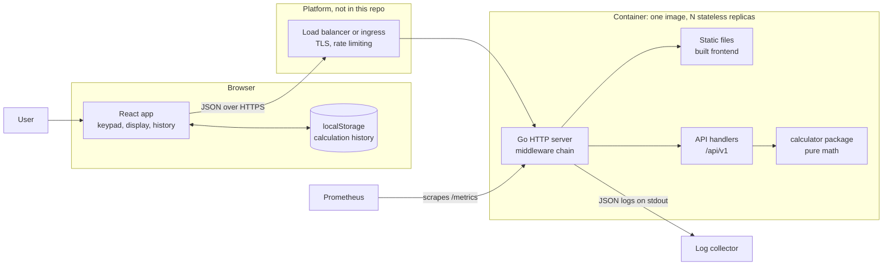
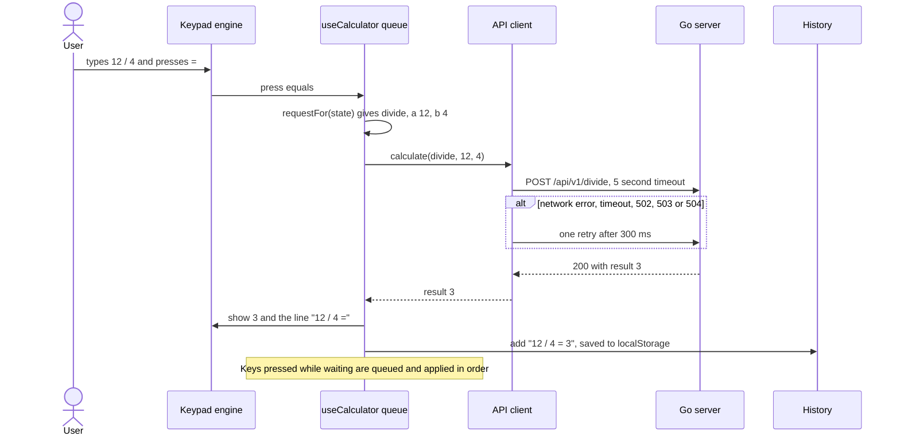
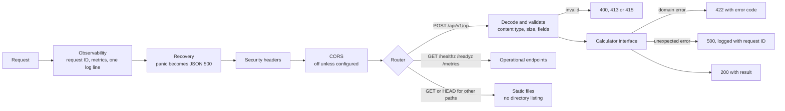
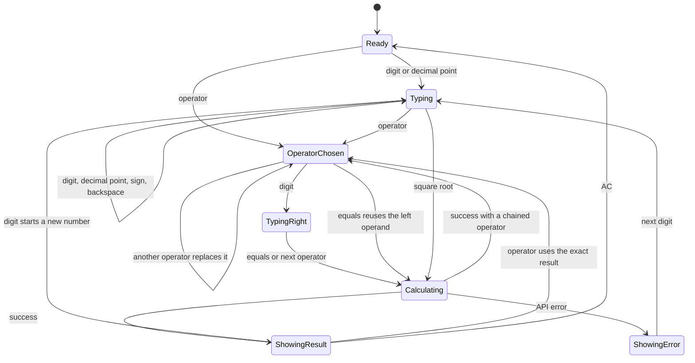
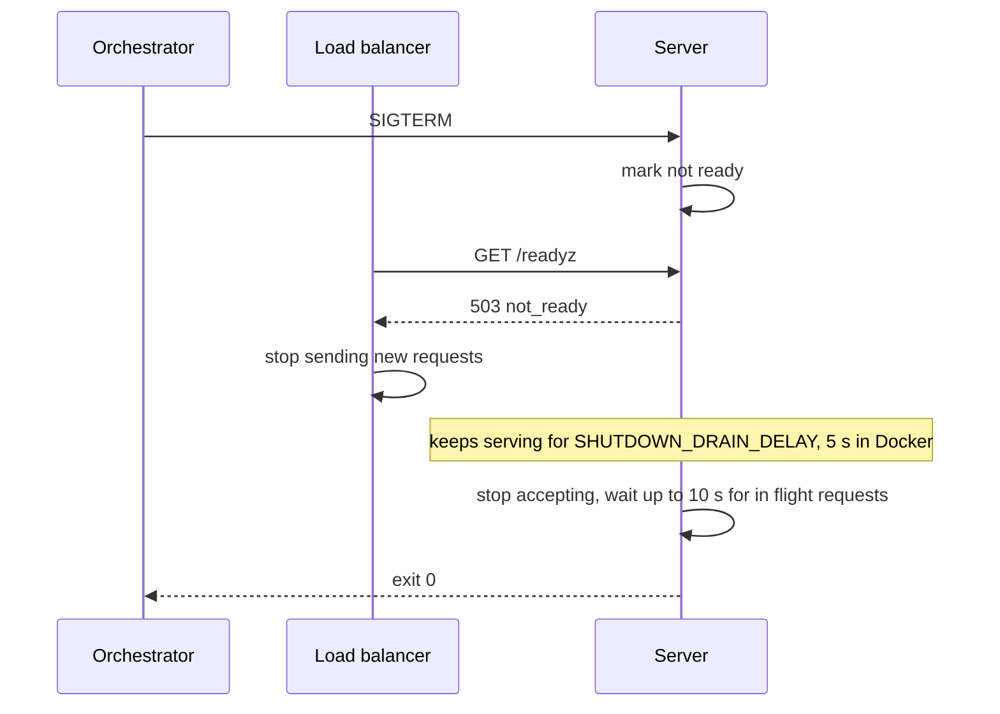
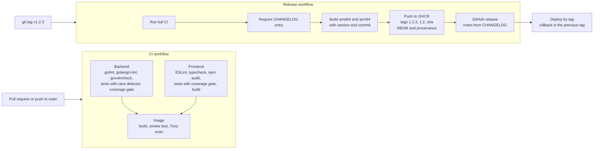

# Sezzle Calculator

A full stack calculator. The React and TypeScript frontend is a keypad calculator with calculation history, and every calculation is done by a Go REST API.

Supported operations: add, subtract, multiply, divide, power, square root and percentage.

## Contents

- [Architecture](#architecture)
- [Project layout](#project-layout)
- [Running it](#running-it)
- [Using the calculator](#using-the-calculator)
- [API](#api)
- [How a calculation flows](#how-a-calculation-flows)
- [Calculation history](#calculation-history)
- [Production readiness](#production-readiness)
- [Security](#security)
- [Performance](#performance)
- [Edge cases](#edge-cases)
- [Tests and coverage](#tests-and-coverage)
- [Release management](#release-management)
- [Design decisions](#design-decisions)
- [Known gaps and what is not included](#known-gaps-and-what-is-not-included)
- [Assumptions](#assumptions)

## Architecture



The browser does no math. It turns key presses into numbers, sends each calculation to the API and keeps the history on the device. The Go server serves both the frontend and the API from one origin, holds no state, and can run as many replicas as needed.

## Project layout

```
backend/                       Go API (standard library plus the Prometheus client)
  cmd/server/                  Entry point: config, version, readiness, graceful shutdown
  internal/calculator/         Pure arithmetic and domain errors, no HTTP
  internal/api/                Routes, validation, JSON responses, middleware, metrics, static files
frontend/                      React + TypeScript (Vite)
  src/App.tsx                  Wires the calculator, history and API client together
  src/api.ts                   Typed API client with timeout and retry
  src/calculator/engine.ts     Keypad state machine (pure functions)
  src/calculator/useCalculator.ts  Connects the engine to the API, queues input
  src/history/                 History storage (localStorage) and hook
  src/components/              Calculator keypad and history panel
docs/openapi.yaml              OpenAPI 3.1 contract for the API
Dockerfile                     Multi-stage, multi-arch image for frontend and backend
CHANGELOG.md                   Release history (Keep a Changelog, SemVer)
.github/workflows/ci.yml       Lint, vulnerability checks, tests with coverage gates, image smoke test and scan
.github/workflows/release.yml  Tag driven release: CI, multi-arch image to GHCR, GitHub release
.github/dependabot.yml         Weekly updates for Go, npm, Docker base images and Actions
```

## Running it

### Option 1: Docker (one command)

```
docker build -t sezzle-calculator .
docker run --rm -p 8080:8080 sezzle-calculator
```

Open http://localhost:8080. The Go server serves the API and the built frontend from the same origin.

### Option 2: Run frontend and backend separately

Requirements: Go 1.27 or newer, Node.js 22 or newer. CI, Docker and local development all use the same Go version, and CI and Docker use Node 24 LTS.

Backend (port 8080):

```
cd backend
go run ./cmd/server
```

Frontend (port 5173, with hot reload):

```
cd frontend
npm install
npm run dev
```

Open http://localhost:5173. The Vite dev server proxies `/api` to `http://localhost:8080`, so no CORS setup is needed during development.

### Configuration

Backend environment variables:

| Variable | Default | Description |
| --- | --- | --- |
| `PORT` | `8080` | Port to listen on |
| `STATIC_DIR` | empty | Folder with the built frontend to serve at `/`. Set automatically in Docker. |
| `ALLOWED_ORIGINS` | empty | Comma separated origins allowed to call the API cross origin, for example `https://calc.example.com`. Use `*` to allow any origin. Empty means CORS is off. |
| `LOG_LEVEL` | `info` | `debug`, `info`, `warn` or `error`. Health check and metrics requests are logged at `debug`. |
| `SHUTDOWN_DRAIN_DELAY` | `0s` (`5s` in Docker) | How long to keep serving after SIGTERM while `/readyz` reports not ready, so the load balancer can stop routing traffic first. |

Frontend build variable:

| Variable | Default | Description |
| --- | --- | --- |
| `VITE_API_BASE_URL` | empty (same origin) | Base URL of the API when it is hosted on a different origin. |

## Using the calculator

- Click the keys or use the keyboard: digits, `.`, `+`, `-`, `*` (or `x`), `/`, `^` for power, `%` for percent of, `r` for square root, `Enter` or `=` to calculate, `Backspace` to delete a digit and `Esc` to clear.
- Paste a number with Ctrl+V. Text that is not a number is rejected with a message.
- The line above the result shows what is being calculated, for example `12 / 4 =`.
- Operations chain like a handheld calculator: `2 + 3 x 4 =` calculates `2 + 3` first, then `5 x 4`.
- `%` means "percent of": `15 % 200 =` gives `30`.
- Errors from the API, such as division by zero, are shown on the display. The next key press clears them.
- **History** lists every calculation, newest first. Click an entry, or focus it and press Enter, to use its result as the next number. History is kept in this browser across reloads, and the Clear button removes it.

## API

The full contract is in [docs/openapi.yaml](docs/openapi.yaml). Base path: `/api/v1`. All requests and responses are JSON.

### Calculate

`POST /api/v1/{operation}`

| Operation | Body | Result |
| --- | --- | --- |
| `add` | `{"a": 2, "b": 3}` | a + b |
| `subtract` | `{"a": 2, "b": 3}` | a - b |
| `multiply` | `{"a": 2, "b": 3}` | a * b |
| `divide` | `{"a": 2, "b": 3}` | a / b |
| `power` | `{"a": 2, "b": 3}` | a to the power of b |
| `sqrt` | `{"a": 9}` | square root of a |
| `percentage` | `{"a": 15, "b": 200}` | a percent of b |

Example:

```
curl -X POST http://localhost:8080/api/v1/add \
  -H "Content-Type: application/json" \
  -d '{"a": 2, "b": 3}'
```

```json
{"operation":"add","a":2,"b":3,"result":5}
```

Square root takes only `a`:

```
curl -X POST http://localhost:8080/api/v1/sqrt \
  -H "Content-Type: application/json" \
  -d '{"a": 81}'
```

```json
{"operation":"sqrt","a":81,"result":9}
```

PowerShell users can use:

```
Invoke-RestMethod -Method Post -Uri http://localhost:8080/api/v1/divide -ContentType application/json -Body '{"a": 10, "b": 4}'
```

### Errors

Errors always have the same shape:

```
curl -X POST http://localhost:8080/api/v1/divide \
  -H "Content-Type: application/json" \
  -d '{"a": 1, "b": 0}'
```

```json
{"error":{"code":"division_by_zero","message":"Division by zero is not allowed"}}
```

| Status | Code | When |
| --- | --- | --- |
| 400 | `invalid_request` | Body is empty, not valid JSON, has unknown fields or trailing data, an operand is missing or not a number, or `b` is sent to `sqrt` |
| 404 | `unknown_operation` | The operation in the path is not supported |
| 404 | `not_found` | Any other unknown `/api` path |
| 405 | `method_not_allowed` | Anything other than POST on an operation (the `Allow` header is set) |
| 413 | `request_too_large` | Body is larger than 4 KB |
| 415 | `unsupported_media_type` | `Content-Type` is set and is not `application/json` |
| 422 | `division_by_zero` | Divide by zero, or zero raised to a negative power |
| 422 | `negative_square_root` | Square root of a negative number |
| 422 | `undefined_result` | Result is not a real number, for example `(-8) ^ 0.5` |
| 422 | `result_out_of_range` | Result overflows a 64 bit float, for example `10 ^ 400` |
| 500 | `internal_error` | Unexpected server error. Details are logged with the request ID, never sent to the client. |

### Operational endpoints

| Endpoint | Purpose |
| --- | --- |
| `GET /healthz` | Liveness. Returns `{"status":"ok","version":"v1.0.0"}` while the process is running. |
| `GET /readyz` | Readiness. Returns 200 normally and 503 `not_ready` once shutdown has started. |
| `GET /metrics` | Prometheus metrics. |

Every response has an `X-Request-ID` header. A valid ID sent by the client or an upstream proxy is kept; otherwise one is generated.

## How a calculation flows

### End to end



### Inside the server



### Keypad state machine

The keypad logic lives in [engine.ts](frontend/src/calculator/engine.ts) as a pure reducer, so every path below is unit tested without React or a network.



## Calculation history

### Options considered

The requirement was to keep history without accounts or login.

| Option | Without login | How long it lasts | Server changes | Privacy | Decision |
| --- | --- | --- | --- | --- | --- |
| **localStorage in the browser** | Yes | Across reloads and restarts, in the same browser on the same device | None | Data never leaves the device | **Chosen** |
| sessionStorage | Yes | Only while the tab is open | None | Same as above | Not chosen: closing the tab loses everything. It is a one line change if that is preferred. |
| Anonymous cookie plus server storage | Yes | Same browser only, like localStorage | Needs a database, new endpoints, and makes the service stateful | History is stored on the server; needs a retention policy, deletion, and a cookie notice in some regions | Not now. Design below. |
| Device fingerprinting | Yes | Unreliable; browsers actively block it | Needs a database | Treated as personal data under GDPR and usually needs consent; users cannot see or reset it | Rejected |
| Accounts and login | No | All devices | Authentication and a database | Clear ownership and deletion | Out of scope for this task |

A cookie on its own adds nothing over localStorage. It only helps if the server stores the history, and then it brings all the costs in the table while still being tied to one browser. localStorage gives users the same experience with no backend state, no extra data on the server and no change to how the service scales.

### How it works

- Every successful calculation is added, newest first, including the intermediate steps of a chain (`2 + 3 = 5`, then `5 x 4 = 20`). Failed calculations are not recorded.
- Clicking an entry puts its full precision result on the display, ready to use as the next number or as the right side of a pending operation.
- At most 50 entries are kept, under a versioned key (`calculator.history.v1`) so the format can change later.
- Stored data is validated when it is read. Corrupted, edited or old format data is dropped instead of breaking the page.
- If storage is blocked by privacy settings or full, history still works for the open page and is not kept after a reload.
- Several open tabs stay in step through the browser's `storage` event.
- A failure while saving history can never turn a correct result into an error.
- The UI depends on a `HistoryStore` interface, not on localStorage, so moving to server storage later is a new implementation of that interface with no component changes.

### If server side history is needed later

1. On first visit, issue an anonymous ID in a cookie: 128 random bits, `HttpOnly`, `Secure`, `SameSite=Lax`, 30 day expiry.
2. Add `GET /api/v1/history` and `DELETE /api/v1/history`, and record entries when calculations succeed.
3. Store entries in Redis with a TTL, or Postgres with a scheduled cleanup, capped per ID.
4. Add a cookie notice where required, a privacy note and a retention policy.
5. Provide a `HistoryStore` implementation that calls the new endpoints.

## Production readiness

### Observability

- **Logs.** One structured JSON line per request with `request_id`, `method`, `path`, `route`, `status` and `duration_ms`. 5xx responses are logged at `error`, health checks and metric scrapes at `debug` so they do not flood the logs. Panics and unexpected errors are logged with the request ID.
- **Request IDs.** The `X-Request-ID` header ties a user report, the proxy logs and the service logs to the same request. IDs from outside are only accepted if they are short and use safe characters, so they cannot be used to inject text into logs.
- **Metrics** at `/metrics`:
  - `http_requests_total{method, route, code}` for traffic and error rate
  - `http_request_duration_seconds{method, route}` histogram for latency percentiles
  - `calculator_operations_total{operation, outcome}`: how each operation is used and how it fails (`ok`, `division_by_zero`, `invalid_request` and so on)
  - `calculator_build_info{version, commit}` to see which release each replica runs
  - Go runtime and process metrics (memory, goroutines, GC, CPU, open files)

  Labels use the matched route pattern, not the raw path, and unknown operations are not counted, so a client cannot create unlimited time series. Suggested alerts: 5xx rate above 1 percent for 5 minutes, p99 latency above 50 ms, and any replica not ready for more than a minute.

### Failure handling

| Failure | What happens |
| --- | --- |
| Bad input | Rejected with 400, 413 or 415 and a clear message before any math runs |
| Math errors (divide by zero, overflow, NaN) | 422 with a specific error code; NaN and infinity are never returned |
| Bug or panic in a handler | Recovered and logged with stack trace and request ID; the client gets a JSON 500 and the process keeps running. If the response had already started, the connection is aborted instead of sending a corrupted body. |
| Slow or stuck clients | Read header, read, write and idle timeouts, a 16 KB header limit and a 4 KB body limit |
| Deploys and scale down | See the shutdown sequence below |
| Process hangs or crashes | Docker `HEALTHCHECK` (built into the binary as `server -healthcheck`, since the distroless image has no curl) and `/healthz` let the orchestrator restart it |
| Network errors and timeouts in the browser | Each request times out after 5 seconds. Network errors, timeouts and 502, 503 or 504 responses are retried once after 300 ms. Retrying is safe because calculations have no side effects. 4xx errors are not retried. |
| Backend completely down | The UI shows "Could not reach the calculator service. Please try again." and the next key press clears it |
| Slow responses | The display dims while a request is running, and keys typed in the meantime are queued, not lost |
| Browser storage blocked or full | History keeps working in memory for the open page |

### Graceful shutdown



This was tested against the running container with `docker stop`: the logs show the drain, then "server stopped cleanly".

### Scaling

- The service is stateless, so it scales horizontally behind any load balancer. No sessions, no sticky routing, no shared storage. History lives in the browser, so it adds no server load.
- One replica handles tens of thousands of requests per second (see [Performance](#performance)), so replicas exist for availability rather than throughput. Run at least two in production, and scale on CPU or request rate.
- In Kubernetes, use `/healthz` for the liveness probe, `/readyz` for the readiness probe, and a `preStop` delay or `SHUTDOWN_DRAIN_DELAY` so endpoints are removed before shutdown.
- Go 1.25 and later set `GOMAXPROCS` from the container CPU limit automatically. Set `GOMEMLIMIT` to about 90 percent of the memory limit so the garbage collector works harder before the container is killed.
- The frontend is static. Hashed files in `/assets/` are sent with `Cache-Control: public, max-age=31536000, immutable`, and `index.html` with `no-cache`, so the UI can sit behind a CDN and new releases are picked up immediately. 404s are not cached, which matters during rolling deploys when old and new versions run side by side.
- API responses are `no-store`, since every result depends on the request body.

## Security

### Threats and how they are handled

| Threat | Mitigation | Where |
| --- | --- | --- |
| Malformed or hostile input | Strict JSON decoding: unknown fields, wrong types, trailing data (including a stray `}` or `]`), numbers outside float64 and non-finite operands are rejected. `Content-Type` must be JSON. | `api/handler.go`, `calculator.go` |
| Resource exhaustion (large bodies, slow clients, Slowloris) | 4 KB body limit, 16 KB header limit, read header timeout 5 s, read and write timeouts 10 s, idle timeout 60 s | `api/handler.go`, `cmd/server/main.go` |
| Log injection and log forging | Incoming `X-Request-ID` is only reused if it is at most 64 characters of `A-Z a-z 0-9 . _ -`; otherwise a new one is generated. Logs are structured JSON, so values cannot break lines. | `api/middleware.go` |
| Metrics cardinality attacks | Metric labels use the matched route pattern, a fixed set of methods and known operations only, so clients cannot create new time series | `api/middleware.go`, `api/metrics.go` |
| Information leakage | Unexpected errors and panics return a generic `internal_error`; details and stack traces go only to the logs with the request ID. `Referrer-Policy: no-referrer`. | `api/handler.go`, `api/middleware.go` |
| Cross-site scripting | React escapes all rendered text; there is no `dangerouslySetInnerHTML`, `innerHTML` or `eval`. History read from storage is validated before rendering. The CSP below blocks inline and third party scripts. | frontend, `history.ts` |
| Clickjacking | `frame-ancestors 'none'` in the CSP and `X-Frame-Options: DENY` | `api/middleware.go` |
| MIME sniffing | `X-Content-Type-Options: nosniff` and an explicit `Content-Type` on every API response | `api/middleware.go`, `api/handler.go` |
| Injected base URLs, forms or plugins | CSP `base-uri 'none'; form-action 'none'; object-src 'none'` | `api/middleware.go` |
| Path traversal and file exposure | `http.Dir` cleans paths, directory listings are disabled, dotfiles such as `.env` or `.git` return 404, and only GET and HEAD are served | `api/static.go` |
| Unwanted cross-origin calls | CORS is off by default; allowed origins are an explicit list | `api/middleware.go` |
| Corrupted or tampered browser storage | History is validated field by field on load, length capped, and dropped if invalid | `history.ts` |
| Privacy | No accounts, no cookies, no tracking and no third party requests. History never leaves the browser and can be cleared. | frontend |

The full Content Security Policy is `default-src 'self'; base-uri 'none'; form-action 'none'; object-src 'none'; frame-ancestors 'none'`. It assumes the page and the API share an origin, which is how the Docker image serves them. If the frontend is hosted elsewhere with `VITE_API_BASE_URL` pointing at the API, the host that serves the page must set a CSP that allows that API in `connect-src`.

### Container

- Distroless static base image: no shell, no package manager, no libc. The binary is static (`CGO_ENABLED=0`).
- Runs as the `nonroot` user. CI checks this on every build.
- The app writes nothing to disk, so it runs with a read-only root filesystem and every Linux capability dropped. This was tested:

  ```
  docker run --read-only --cap-drop ALL --security-opt no-new-privileges -p 8080:8080 sezzle-calculator
  ```

  In Kubernetes, the equivalent is `readOnlyRootFilesystem: true`, `runAsNonRoot: true`, `allowPrivilegeEscalation: false` and `capabilities: { drop: [ALL] }`.

### Supply chain and CI

- **Static analysis:** golangci-lint with `gosec` for Go, ESLint and strict TypeScript for the frontend.
- **Known vulnerabilities:** `govulncheck` for Go code and the standard library, `npm audit` for production npm dependencies, and a Trivy scan of the final image. CI fails on high or critical findings.
- **Reproducible installs:** `npm ci` from the lockfile, and `go.sum` for Go modules.
- **Pinned actions:** every GitHub Action is pinned to a full commit SHA, so a moved tag cannot change the pipeline.
- **Least privilege tokens:** workflows default to `contents: read`. Only the release publish job gets `packages: write` and `contents: write`. No other secrets are used.
- **Traceable releases:** release images carry an SBOM and build provenance, and each image tag maps to one commit.
- **Updates:** Dependabot opens weekly pull requests for Go, npm, Docker base images and Actions.

### Checks run on this codebase

| Check | Result |
| --- | --- |
| `govulncheck ./...` | No vulnerabilities found |
| golangci-lint with `gosec` | 0 issues (the only findings were file permissions in test setup, now fixed) |
| `npm audit --omit=dev --audit-level=high` | 0 vulnerabilities |
| Trivy image scan, high and critical | 0 in the OS layer and the Go binary |
| Hardened container run (read-only, no capabilities, no new privileges) | Healthy and serving |
| Manual probing of the edge cases in [Edge cases](#edge-cases) | All handled as documented |

### Handled outside the app

TLS and HSTS, per client rate limiting, a web application firewall if wanted, and keeping `/metrics` off the public ingress belong to the gateway in front of the service. See [Known gaps](#known-gaps-and-what-is-not-included).

## Performance

### Load test

Measured with [hey](https://github.com/rakyll/hey) against the Docker image: 50 concurrent clients for 20 seconds, `POST /api/v1/divide`.

| Measure | Result |
| --- | --- |
| Throughput | 36,200 requests per second |
| Errors | 0 of 724,468 requests |
| Latency p50 / p95 / p99 | 1.2 ms / 2.6 ms / 3.7 ms |
| Memory (RSS) during the test | about 18 to 22 MB |
| Goroutines after the test | 9, so nothing leaks |

This ran on a desktop (Intel i7-12700F) through Docker Desktop's port forwarding, which adds overhead, so production numbers should be at least this good. The `calculator_operations_total` counter matched the number of requests sent, which also checks the metrics.

### Handler cost and optimizations

A benchmark measures one request through the full middleware chain, without network overhead:

```
cd backend
go test -run "^$" -bench . -benchmem ./internal/api
```

Profiling with `pprof` showed where allocations came from, and these changes cut them from 35 to 23 per request (bytes per request from about 1,610 to 1,360):

- Constant header values (security headers, `Content-Type`, `Cache-Control`) are assigned as prebuilt slices instead of calling `Header.Set`, which allocated a slice and canonicalized the key on every call.
- The request ID header constant uses its canonical form, so reading and writing it needs no conversion.
- The request log uses `slog.LogAttrs` with typed attributes, which avoids boxing every value in an interface.
- `Content-Type: application/json`, the common case, skips MIME parsing.
- Errors are encoded from a struct instead of a map, and the no-op logger uses `slog.DiscardHandler`.
- The request ID buffer is a stack array.

The remaining allocations are the JSON decoder, the two operand pointers (needed to tell a missing field from `0`), the response encoder and the request ID string. Cutting those further would mean hand written JSON parsing, which is not worth the risk for a few hundred nanoseconds.

## Edge cases

### Backend

| Input | Behaviour |
| --- | --- |
| Divide by zero, including `-0` | 422 `division_by_zero` |
| `0 ^ -1` | 422 `division_by_zero` |
| `(-8) ^ 0.5` | 422 `undefined_result` |
| `10 ^ 400`, `1e308 x 10` | 422 `result_out_of_range` |
| `1e-308 / 1e308` (underflow) | `0` |
| `-0` as an operand or result | Returned as `0` |
| `7 % of 300` | Exactly `21`. Multiplies first to stay exact, and divides first only if `a x b` would overflow. |
| `0 ^ 0` | `1`, as in IEEE 754 and Go's `math.Pow` |
| Number literal outside float64, such as `1e400` | 400 |
| Integer above 2^53, such as `9007199254740993` | Rounded to the nearest float64. See assumptions. |
| `a` missing, `null`, a string or a boolean | 400 with the field named |
| `b` sent to `sqrt` | 400. `"b": null` is treated as absent. |
| Unknown field, array, empty body | 400 |
| Trailing data after the object, including a stray `}`, `]` or `null` | 400. Go's `Decoder.More` misses a stray closing bracket, so the handler decodes again and requires a clean end of input. |
| NaN or infinity passed to the calculator package directly from Go | `ErrInvalidOperand` (400 if it ever reached the API). JSON cannot carry these values, but IEEE rules would otherwise turn `1 ^ NaN` into `1`. |
| Body over 4 KB | 413 |
| `Content-Type` other than JSON | 415. `Application/JSON` and `application/json; charset=utf-8` are accepted, and a missing header is accepted. |
| `/api/v1/ADD`, `/api/v1/`, `/api/v1/add/` | 404 |
| GET on an operation | 405 with `Allow: POST` |
| `/assets/` or any directory | 404, never a listing |
| POST to a static path | 405 with `Allow: GET, HEAD` |
| Dotfiles such as `/.env` or `/.git/config` | 404, even if present in the static folder |
| Unsafe `X-Request-ID` (spaces, newlines, over 64 characters) | Replaced with a generated ID |
| Panic before the response starts | JSON 500 and a log entry with the request ID |
| Panic after the response started | Connection aborted, so the client sees a failure rather than a corrupted body |

### Frontend

| Situation | Behaviour |
| --- | --- |
| More than 15 digits | Extra digits are ignored (the precision float64 holds reliably) |
| Second decimal point, leading zeros | Ignored |
| Change sign before typing | Starts a negative number (`+/-`, then `3`, gives `-3`) |
| Backspace on the last digit | Shows `0`. Backspace does not edit a result. |
| `1 / 3 x 3` | Exactly `1`. The display is rounded to 15 digits, but the full value is used for the next step. |
| `0.1 + 0.2` | Shows `0.3`. The API returns the exact float; rounding is for display only. |
| `=` straight after an operator | Reuses the left operand: `5 x =` gives `25` |
| Two operators in a row | The second replaces the first |
| Square root of the right operand | Keeps the pending operation: `5 + 9 sqrt =` gives `8` |
| Typing while a request is running | Keys are queued and applied in order |
| Pasted text that is not a number | Rejected with a message. The pending operation is kept. |
| `=`, `sqrt` or an operator while an error is shown | Ignored, so the number hidden behind the message is never used. Typing a number, pasting, picking from history or AC clears the error. |
| Typing after a paste or a history pick | Starts a new number instead of appending (no `1e-75`) |
| Caps Lock on | `X` and `R` shortcuts still work |
| Ctrl, Cmd or Alt shortcuts, IME composition | Left to the browser |
| Enter on a focused history entry | Selects the entry instead of calculating |
| Timeout, network error, 502, 503 or 504 | One retry, then a clear message |
| Error body that is not JSON, malformed success body | Clear message instead of a crash |
| Stored history corrupted, edited, too long or from an old format | Bad entries are dropped, at most 50 kept |
| Storage blocked or full | History works in memory for the open page |
| History changed in another tab | This tab updates |
| History listener throws | The result is still shown and the calculator keeps working |

## Tests and coverage

Backend:

```
cd backend
go test -cover ./...
go test "-coverprofile=coverage.out" ./...
go tool cover "-html=coverage.out"
go test -run "^$" -bench . -benchmem ./internal/api
```

Frontend:

```
cd frontend
npm test
npm run coverage
```

The frontend coverage report is written to `frontend/coverage/index.html`.

Latest results:

| Package | Statements |
| --- | --- |
| backend `internal/calculator` | 100% |
| backend `internal/api` | 96.3% |
| frontend (all files) | 100% (98.75% of branches) |

CI fails if coverage drops below 90 percent for the backend `internal` packages, or below 95 percent of statements and lines and 90 percent of branches and functions for the frontend.

`cmd/server` only wires configuration and starts the server. It is checked by running the app rather than by unit tests: CI starts the built container and smoke tests it, and SIGTERM draining was tested against the container by hand.

What the tests cover:

- `calculator_test.go`: every operation and the math edge cases in the table above.
- `handler_test.go`: every endpoint over HTTP, every error code, content type rules, size limits, static file hardening and cache headers, security headers, CORS, panic recovery before and after the response starts, readiness, version reporting, request IDs, log output and metrics. A fake calculator checks that unexpected errors are logged and never shown to the client. Includes the benchmark.
- `engine.test.ts`: the keypad state machine, including precision, chaining, recall, paste, errors and keyboard mapping.
- `App.test.tsx`: user flows through the whole UI with the keypad and keyboard, API errors, queued input, and history (recording, reuse, keyboard selection, clearing, not recording failures).
- `history.test.ts`: storage validation, caps, blocked and full storage, and changes from other tabs.
- `useCalculator.test.ts`: the input queue survives a failing listener.
- `api.test.ts`: the API client, including timeouts, one retry on network and gateway errors, and no retry on client errors.
- `validation.test.ts`, `operations.test.ts`: input parsing and number formatting.

Every push and pull request runs, in CI: `gofmt`, golangci-lint with `gosec`, `govulncheck`, Go tests with the race detector, ESLint, TypeScript type checks, `npm audit` on production dependencies, the frontend production build, a Docker build, a smoke test of the running container and a Trivy scan of the image.

## Release management



**Versioning.** Releases follow Semantic Versioning and are cut from git tags (`v1.2.3`). The API has its own version in the path (`/api/v1`). A breaking API change would ship as `/api/v2` next to `v1`, so existing clients keep working until they move.

**Changelog.** Every change goes under `Unreleased` in [CHANGELOG.md](CHANGELOG.md). Cutting a release moves those lines under the new version.

**Cutting a release.**

```
# 1. Move the Unreleased notes in CHANGELOG.md under "## [1.1.0] - YYYY-MM-DD" and merge to main.
# 2. Tag the merged commit and push the tag.
git tag -a v1.1.0 -m "v1.1.0"
git push origin v1.1.0
```

The [release workflow](.github/workflows/release.yml) then reruns CI on the tagged commit, fails if `CHANGELOG.md` has no entry for the version, builds the image for `linux/amd64` and `linux/arm64` (cross compiled, no emulation) with the version and commit baked in, pushes it to GitHub Container Registry with an SBOM and build provenance, and creates the GitHub release from the changelog section.

**Knowing what is running.** The version and commit are compiled into the binary and reported by `/healthz`, the startup log line and the `calculator_build_info` metric. A dashboard can show at a glance which version each replica runs during a rollout.

**Deploying and rolling back.** Image tags are immutable, so a deploy points at an exact version and a rollback is a redeploy of the previous tag. No other step is needed: the service holds no state and runs no migrations. The frontend and backend ship in the same image, so they can never be out of step. History in the browser uses a versioned key, so a new release can change the format without breaking old data. Readiness checks and connection draining let a rolling update replace replicas without dropping requests. Watch the 5xx rate and p99 latency during a rollout, and roll back if they move.

**Dependencies.** Dependabot opens weekly pull requests for Go modules, npm packages, Docker base images and GitHub Actions, grouped so they are quick to review. Every update goes through the same CI gates. GitHub Actions are pinned to commit SHAs, so a moved tag cannot change what runs in the pipeline.

**Repository settings to turn on** (they live in GitHub, not in code): protect `main`, require pull requests and passing CI checks before merging, and allow only maintainers to push `v*` tags.

## Design decisions

**SOLID, applied where it pays off.**

- *Single responsibility.* Each unit has one reason to change. `calculator` changes when the math changes, `api` when the HTTP contract changes, `cmd/server` when configuration or process lifecycle changes. Each middleware does one job. On the frontend, `engine.ts` holds keypad logic, `api.ts` handles transport, `history.ts` handles storage, the hooks coordinate, and the components render.
- *Open for extension, closed for modification.* Operations live in a table, and domain errors map to HTTP through a table. Adding an operation means adding an entry, not editing branches. Middleware composes without the handlers knowing about it.
- *Liskov substitution.* Any implementation of `api.Calculator` works with the handler; the tests swap in a failing one. Any `HistoryStore` works with the UI; the tests use an in-memory one.
- *Interface segregation.* The handler depends on a two method interface (`Arity`, `Calculate`). The UI depends on a three method `HistoryStore` and a single `CalculateFn` function type.
- *Dependency inversion.* High level code depends on those abstractions, and `main` (backend) or `App` (frontend) wires in the real implementations.

I did not go further, for example with a dependency injection framework or a repository layer. A service this size gains nothing from them, and they would only add indirection.

**One endpoint per operation.** `POST /api/v1/add` reads clearly, maps directly to the requirement and lets each operation have its own validation (for example `sqrt` takes one operand). The version prefix leaves room for breaking changes later.

**The calculator package knows nothing about HTTP.** It is a table of operations that returns typed errors. The API layer maps those errors to status codes and stable error codes, which keeps the math easy to test and reuse.

**Strict input validation on the server.** Operands are pointers, so a missing field is different from `0`. Results that are NaN or infinity are never returned.

**Error codes for programs, messages for people.** Every error has a stable `code` that clients can switch on and a readable `message` that the UI shows as is.

**Small dependency footprint in Go.** Go's router covers what this service needs, so the only third party module is the official Prometheus client. Logging uses `log/slog` with JSON output.

**The frontend does not do math.** All arithmetic goes through the API, as the task asks. The frontend builds numbers from key presses, keeps the exact value behind the rounded display, and formats results.

**A keypad, because people know how calculators work.** The display always shows the number being typed, the line above shows the pending expression, and the selected operator stays highlighted. Keyboard, paste and touch all work. On wide screens history sits next to the keypad; on phones it sits below.

**Floating point.** The API returns full float64 results, for example `0.1 + 0.2` returns `0.30000000000000004`. The UI shows 15 significant digits, so the user sees `0.3`, but keeps the full value for the next step.

**Accessibility.** Keys and history entries are real buttons with accessible names, the display is a live region so screen readers announce results, the busy state is exposed with `aria-busy`, and focus outlines are visible. Light and dark themes follow the system setting.

**Deployment.** The Docker image is built in three stages (Node build, Go build, distroless runtime). It runs as a non root user, contains only the static binary and the built frontend, and has a built in health check. Serving the frontend from the Go server keeps one origin, so no CORS is needed in production.

**A written API contract.** [docs/openapi.yaml](docs/openapi.yaml) describes every endpoint, request, response and error code in OpenAPI 3.1. Other teams can generate clients from it, or import it into tools such as Postman or Swagger UI.

## Known gaps and what is not included

Each item was left out on purpose. The reason and the way to add it are listed so the trade-off is visible.

### Product

| Not included | Why | How to add it |
| --- | --- | --- |
| History across devices | Needs accounts or server storage, which the task did not ask for | Accounts plus the server side history design above |
| Server side history with an anonymous cookie | Makes the service stateful and stores user data on the server for no gain over localStorage | See [If server side history is needed later](#if-server-side-history-is-needed-later) |
| Recognising the device (fingerprinting) | Unreliable, blocked by browsers, and treated as personal data that usually needs consent | Not recommended |
| Expressions with operator precedence (`2 + 3 x 4 = 14`) | The keypad follows the immediate execution model of handheld calculators, which people expect | A parser in the frontend, or a new `POST /api/v1/evaluate` endpoint that takes an expression |
| Repeated equals (`=` again repeats the last operation) | Rarely used, and easy to misread | Store the last operator and right operand in the engine |
| Memory keys (M+, MR) | History covers most of the need | New engine actions |
| Arbitrary precision decimals | float64 is accurate to about 15 digits, which is enough for a basic calculator | Swap the calculator package to a decimal library and send numbers as strings |
| Localization (translations, decimal comma display) | Single language was enough for the task. The `,` key already works as a decimal point. | `Intl.NumberFormat` for display and a translation library |
| Offline mode | Every calculation needs the API by design | A service worker could cache the UI, but results still need the server |

### Platform and operations

| Not included | Why | How to add it |
| --- | --- | --- |
| TLS | Terminated at the load balancer or ingress | Platform configuration |
| Rate limiting | Per process limits do not add up across replicas | Gateway or ingress rate limiting per client IP |
| Access control on `/metrics` | Better handled by the network | Do not route `/metrics` on the public ingress |
| Response compression | A CDN or ingress compresses better and caches the result. The JS bundle is 155 KB, 50 KB gzipped. | Enable gzip or brotli at the CDN or ingress |
| Distributed tracing | One service and one hop; request IDs already correlate logs | OpenTelemetry HTTP middleware when the service starts calling others |
| Frontend error reporting and real user monitoring | Browser errors are shown to the user but not reported anywhere | An error tracking service, or a small `POST /api/v1/client-errors` endpoint |
| Browser end to end tests in CI | The UI is covered by component tests in jsdom and was checked by hand in a real browser | A Playwright suite run against the container in the image job |
| Load tests in CI | Load was measured by hand (see [Performance](#performance)) | A scheduled k6 or hey job with thresholds on p99 latency and errors |
| Kubernetes manifests, Helm chart, Terraform | The deployment target is not known | A Deployment with the probes above, a Service, an HPA and a PodDisruptionBudget |
| Canary releases and feature flags | Not needed at this size; rolling updates with readiness are enough | Argo Rollouts or a flag service |

### Known behaviours of the API

- Field names are matched case insensitively (`"A"` works as `a`) and a repeated key keeps the last value. This is how Go's `encoding/json` works. The stricter `encoding/json/v2` can be adopted once it is stable.
- Numbers are float64, so integers above 2^53 are rounded.
- A request with no `Content-Type` header is accepted, to be friendly to simple clients.

## Assumptions

- Numbers are 64 bit floats. Arbitrary precision decimals would be a change in the calculator package only.
- Percentage is "a percent of b". A handheld style `%` key that depends on the previous operation is ambiguous, so the API keeps one clear meaning.
- The API is public and has no authentication. TLS, rate limiting and access to `/metrics` are handled by the gateway in front of it.
- Typed input is limited to 15 digits, which is the precision a float64 can hold reliably.
- Calculation history is not sensitive, so keeping it in the browser is acceptable. Users can clear it at any time.

## AI usage

AI tools were used while building this project. The prompts are listed in [PROMPTS.md](PROMPTS.md).
